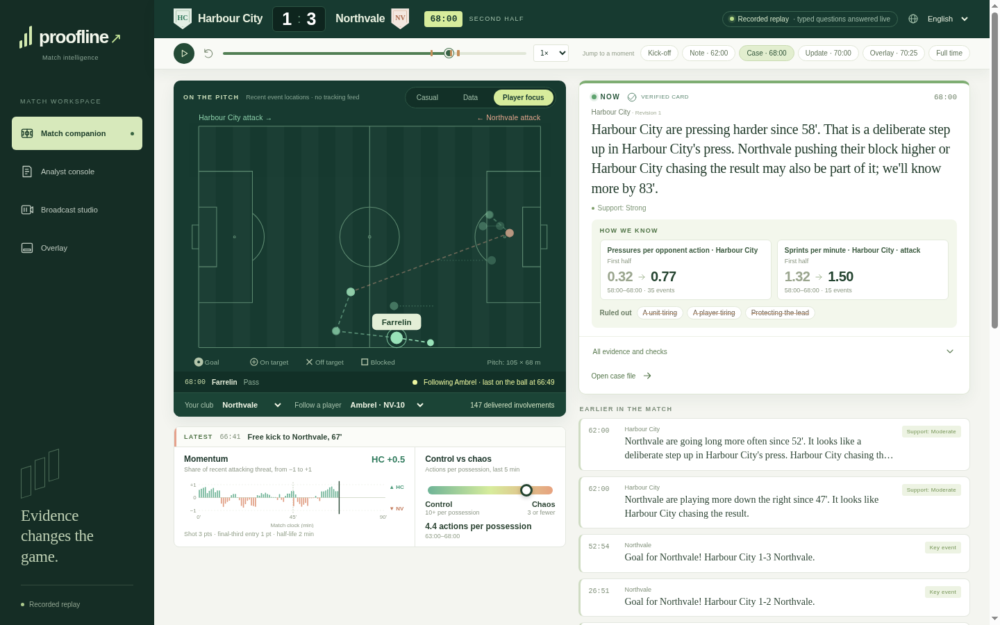
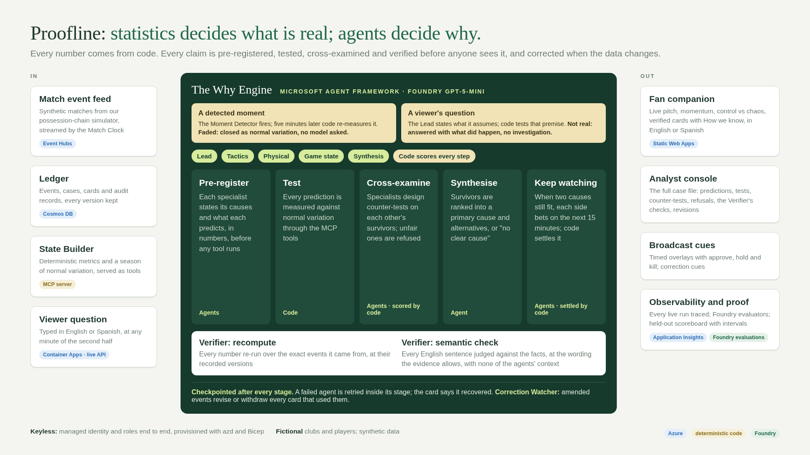
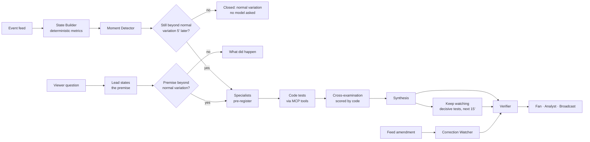
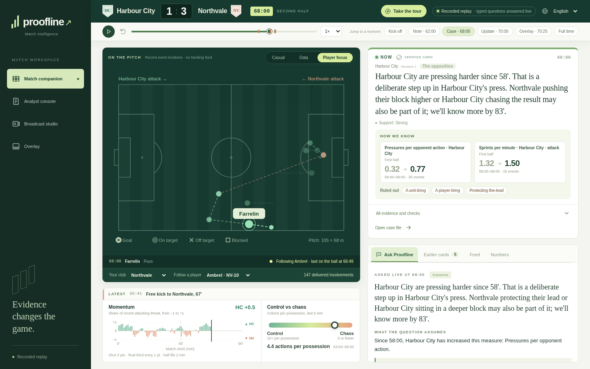
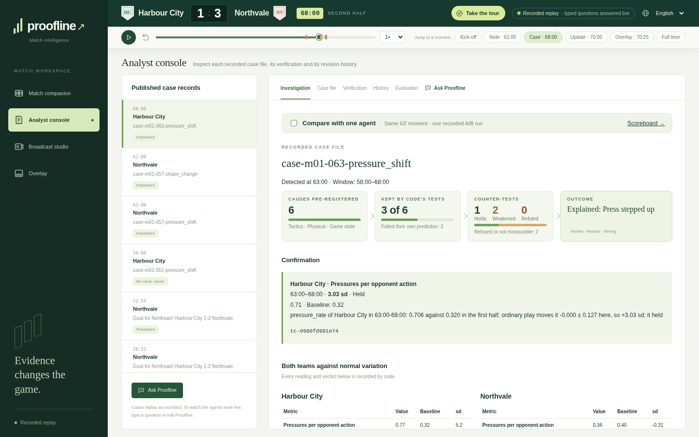
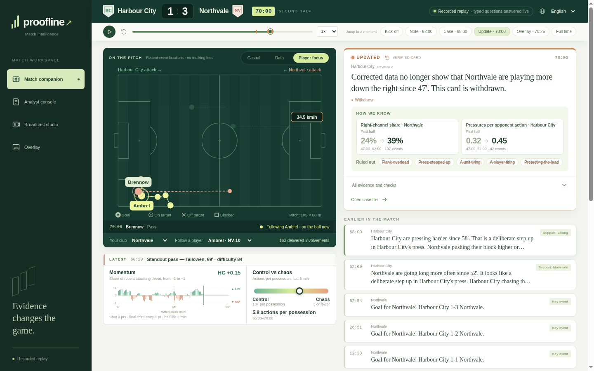
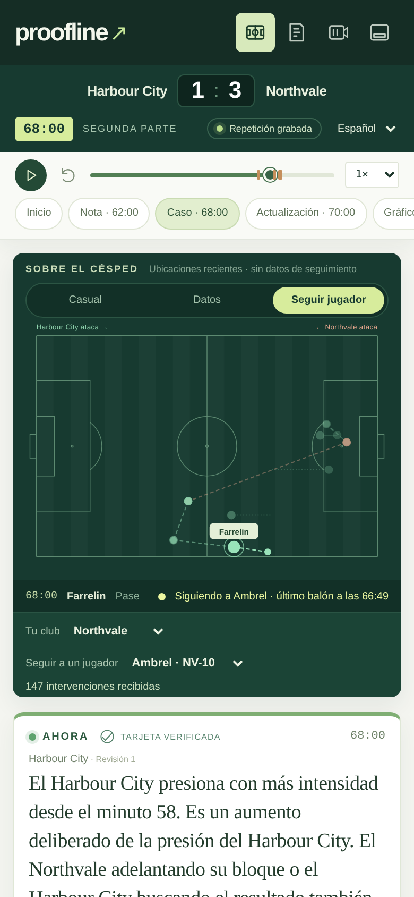

# Proofline

**Match intelligence that shows its evidence, knows its limits, and corrects itself.**

[](https://github.com/elyorman/Proofline/actions/workflows/ci.yml)

Built for the Microsoft × Premier League "Inside the Game" Developer Hackathon, category **Best Multi-Agent System**. Every club, player and competition is fictional, and all match data is synthetic.

**Public link (no sign-in):** https://nice-coast-044d8740f.5.azurestaticapps.net. It replays a recorded match, and answers any typed question about it live, in Azure.



**A two-minute tour:** [the 68' card and its evidence](https://nice-coast-044d8740f.5.azurestaticapps.net/#/fan?t=68:00&lang=en) · [the 70' correction](https://nice-coast-044d8740f.5.azurestaticapps.net/#/fan?t=70:00&lang=en) · [the agents' investigation](https://nice-coast-044d8740f.5.azurestaticapps.net/#/analyst?t=68:00&lang=en) · then type your own question in Ask Proofline, below the cards, and watch it answered live. Step-by-step testing instructions are in [`docs/submission.md`](docs/submission.md#testing-instructions-for-judges).

## The problem

A live stats feed can tell you that Harbour City's pressing has jumped since 58'. It cannot tell you why. Harbour City might have decided to press higher. They might be chasing a 1-3 scoreline. Northvale might have pushed up into the press. All three move the same numbers. A language model will pick one and explain it fluently. It will just as fluently explain a change that never happened if the viewer's question assumes it.

Proofline splits the job: **statistics decides what is real; agents decide why.**

- **Code decides whether a change is real** before any model sees it. Every change is measured against the normal variation of a season of simulated matches. A viewer's question is checked the same way. Asked "Why is Harbour City's defence tiring?", Proofline answers "it isn't, beyond ordinary play" when the numbers say so.
- **Three specialist agents** (tactics, physical, game state) propose causes. Each one pre-registers, as numbers, what its cause would predict. Code runs the tests with the State Builder's tools, which our MCP server serves, and agents never compute a statistic.
- **They cross-examine each other.** Each surviving cause is challenged by the other agents with counter-tests they design. Code refuses unfair tests and scores the rest.
- **It keeps watching when the evidence can't decide.** If two causes still fit, the card says so. Each side then pre-registers a decisive test for the next 15 minutes. Code settles it then and publishes the result as a new revision.
- **An independent Verifier checks everything first.** It recomputes every number from the exact events it came from. It also checks every sentence against the facts, at the wording the evidence allows. Nothing reaches a fan, analyst or overlay without it.
- **It corrects itself.** When the feed amends events, the Correction Watcher finds every card that used them. It re-verifies each one, then revises or withdraws it on every surface. Earlier revisions stay visible.



<details>
<summary>The same flow as a diagram GitHub renders</summary>



</details>

## What we measured

All results come from a held-out split, scored against sealed ground truth. It was run once, after the agents were frozen at git tag `agents-frozen`; the run was resumed once, after a machine reboot. A CI guard keeps product code from reading the ground truth. Every figure below is quoted from a record in [`eval/records/`](eval/records/), and CI fails if this README quotes a figure no record holds. The [full scoreboard](#full-scoreboard), with every interval, is at the end.

Three variants ran on the same model (gpt-5-mini) with the same tools and tool budget:

- **A. Proofline:** the full design, with three specialists.
- **B. Single agent:** the same design, with one agent doing all three specialists' work.
- **P. Plain agent:** one model with the same MCP tools, asked the viewer's question directly. It has no premise test, no pre-registration, no cross-examination and no Verifier.

### Viewer questions

The held-out set has 80 questions. 78 were scored: 28 whose premise is true and 50 whose premise is false. The other two ask about a planted change that never became observable. Each cell is the rate with its 95% Wilson interval.

| | A | B | P |
|---|---|---|---|
| False premises turned away | 98.0% [89.5, 99.6] | 96.0% [86.5, 98.9] | 70.0% [56.2, 80.9] |
| Questions answered with a false cause, first answer | 15.4% [9.0, 25.0] | 15.4% [9.0, 25.0] | 34.6% [25.0, 45.7] |
| Questions answered with a false cause, after the follow-up | 3.8% [1.3, 10.7] | 9.0% [4.4, 17.4] | 34.6% [25.0, 45.7] |
| Causes named that were right, after the follow-up | 75.0% [46.8, 91.1] | 50.0% [26.8, 73.2] | 37.2% [24.4, 52.1] |
| True premises answered with the planted cause, first answer | 32.1% [17.9, 50.7] | 32.1% [17.9, 50.7] | 57.1% [39.1, 73.5] |

P has no follow-up, so both of its false-cause rows are the same.

- **Proofline makes far fewer false claims than the plain agent.** After the follow-up, A − P is -30.8 pp for false causes [-42.9, -19.2] and +28.0 pp for false premises turned away [15.9, 40.4]. Each is a paired bootstrap 95% interval over matches.
- **Much of that is restraint, and what it does claim is more often right.** Proofline names a cause less often than the plain agent. When it does, after the follow-up it is right more often: +37.8 pp [3.8, 68.4].
- **The price is coverage.** The plain agent names the right cause for more true premises: A − P is -25.0 pp [-50.0, 0.0]. When the evidence is unclear, Proofline says so instead of guessing.
- **Three specialists did not measurably beat one.** Every A − B interval reaches zero. The closest is false causes after the follow-up, at -5.2 pp [-11.7, 0.0]. The gain over the plain agent comes from the design (statistics first, pre-registration, independent verification), not from splitting the specialists. We report it as measured.

### Moments the detector found

The held-out split has 30 planted matches (28 scored, 2 not observable) and 10 decoys with nothing planted.

| | A | B |
|---|---|---|
| Planted causes recovered | 35.7% [20.7, 54.2] | 32.1% [17.9, 50.7] |
| Published causes that were right | 32.6% [20.5, 47.5] | 40.0% [27.0, 54.5] |
| Decoys left alone | 70.0% [39.7, 89.2] | 70.0% [39.7, 89.2] |

A − B is +3.6 pp for recall [-14.3, 21.4] and -7.4 pp for precision [-20.9, 7.0]. After the follow-up, both variants claim less without becoming more precise: A recovers 17.9% and is right 29.6% of the time. On these moments the follow-up did not carry over from the dev split to the held-out split. Here Proofline names the planted cause about a third of the time.

### The Verifier

We plant false claims into real cards published on the dev split, then count what the Verifier catches. The claims are:

- a wrong evidence or baseline number, or a number with no source;
- a change in the wrong direction, or credited to the wrong team;
- more certainty than the support allows;
- a cause the card never investigated;
- a primary change pointing the wrong way.

We also check whether the Verifier rejects the same cards left untouched. There are 75 seeded claims from 10 cards:

| Verifier model | False claims caught | Untouched cards rejected |
|---|---|---|
| gpt-5-mini (the one shipped) | 98.7% | 0.0% [0.0, 27.8] |
| Phi-4 | 98.7% | 0.0% [0.0, 27.8] |

Code's own checks catch the wrong numbers. Only the semantic check catches a wrong direction, the wrong team or overcertainty. With only 10 untouched cards, the false-rejection interval is wide. The two models tie here, so the choice rests on what else we saw. We re-verified the demo match's recorded investigations with Phi-4 (`--reverify`). It rejected a sound card that stated a strongly supported cause as fact beside a pending follow-up, and gpt-5-mini passes that card. The Verifier stays on gpt-5-mini, the model the held-out runs used.

### An outside judge

Microsoft Foundry's built-in evaluators read every card revision the demo take published, in both languages, and the answers that turned a premise away. Each text is judged against the same facts our Verifier saw ([`eval/foundry/demo-take.json`](eval/foundry/demo-take.json), from [`eval/foundry_evals.py`](eval/foundry_evals.py)). All 28 texts pass relevance and coherence, 27 pass fluency, and 23 pass groundedness. Four of the five it marks weakly grounded are the settled 63' card, in every version: casual and analyst, English and Spanish. The fifth is the first 63' card in Spanish, a language our own semantic check does not read. An earlier run flagged the settled card's "the numbers still fit all three", which claimed more than the follow-up found; the card now says no check had told the causes apart, and the judge still marks it weakly grounded. The judge is itself a model, so its verdicts vary a little between runs.

## See it

The [public link](https://nice-coast-044d8740f.5.azurestaticapps.net) replays one recorded match, m01 (Harbour City v Northvale), on a shared clock. It starts at 68:00, viewed as a Northvale fan reading Spanish; the language switch is in the top bar. The replay calls no model. A typed question no recording holds goes to the live API in Azure.

- **Fan (`#/fan`).**
  - **The cards:**
    - **62':** cards on Northvale going long more often and playing down the right.
    - **68':** a card on Harbour City's press, with a pending check against two rival causes.
    - **70':** after the feed corrects Northvale's coordinates, the right-flank card is withdrawn in place.
    - **77' and 83':** the follow-ups settle, saying honestly that no check told the causes apart.
  - **How we know** on any card shows its evidence, the causes it ruled out and its revisions.
  - **Ask Proofline** plays five recorded questions. Two have false premises and are turned away; one ("Who will win?") is declined.
  - **Type any other question** about the match so far, in English or Spanish, and it is answered live. The Lead's premise, code's test, the three agents and the Verifier run in Azure, and each stage appears as it is reached. A false premise is answered in seconds; a real investigation takes one to three minutes. Each viewer asks one question at a time, and a day's questions share a budget of model tokens that no single viewer may use more than a fifth of.
- **Analyst (`#/analyst`).** The full case file for every case:
  - **Investigation:** each agent's pre-registered predictions, tool calls, counter-tests, refusals, synthesis and checkpoints.
  - **Verification and revision history:** the Verifier's results and the amendment's diff.
  - **Compare with one agent:** sets the 63' moment beside the single agent's investigation.
  - **Evaluation:** the scoreboard, read from the records.
- **Broadcast (`#/broadcast`) and overlay (`#/overlay`).** Producer cues with approve, hold and kill. The withdrawal cue waits for approval at 70:25.

| A typed question, investigated live | ...and answered, with its verified card |
|---|---|
|  |  |
| **Each specialist's pre-registered causes, tested by code** | **The 70' feed correction withdraws a card in place** |
|  |  |



**Which take is shown.** Re-running the same match does not always give the same explanation. In recorded full-match runs on the frozen agents, the three-agent variant explained the 63' press moment three different ways:

- Harbour City chasing the result, in a run where the Verifier timed out;
- Northvale dropping deeper;
- Harbour City's press, the planted cause.

The single agent named the press and left its follow-up unresolved. Every surface shows the take picked by a written rule, not by eye: the first full-match Studio recording on the frozen agents in which every beat ran. We wrote the rule after these takes existed. It picks the earliest complete take, not the best. In it, the 63' card, shown at 68', names the planted press. Its follow-up leaves it unresolved against two rivals at 83'.

## Run it

**Replay, without Azure or any model call:**

```bash
uv sync
uv run pytest -q          # includes a fresh replay of the whole Studio match with model calls forbidden
uv run proofline-engine generate --script engine/scripts/planted/m01.yaml --out data/m01/
uv run proofline case --match m01 --minute 63 --variant A --kill-agent physical --replay tests/fixtures/studio/m01
                          # the 63' case with Physical stopped mid-case and retried from its checkpoint
cd surfaces/web
corepack pnpm install --frozen-lockfile
corepack pnpm fixtures    # generates the match, replays Studio and exports the web fixtures
corepack pnpm dev
```

**Live, on your own Azure subscription:**

```bash
azd up                                                     # every resource, keyless (Entra ID and roles), and the live API
make deploy-web                                            # the replay on Static Web Apps, pointed at that API
set -a && eval "$(azd env get-values)" && set +a
uv run proofline-engine generate --script engine/scripts/planted/m01.yaml --out data/m01/
uv run proofline case --match m01 --minute 63 --variant A                        # one case, end to end
uv run proofline ask --match m01 --at 68:00 --question "Why are Northvale going long so much?" --variant A
uv run proofline run --mode studio --match m01 --record runs/take                # the whole match through the product
make stream-m01                                            # the match through Event Hubs into Cosmos DB, detector cases printed
uv run uvicorn surfaces.api.app:create --factory --port 8000  # the live API locally, against the same Azure resources
```

**Reproduce the evaluation** (live model calls; the held-out split is meant to be run once):

```bash
uv run proofline-engine suite --suite planted --split heldout
uv run proofline-engine suite --suite decoys --split heldout
make heldout-feeds
uv run proofline batch --data data/heldout --variant A --out runs/held
uv run python -m eval --runs runs/held --split heldout --variant A --after-follow-up
uv run python -m eval.questions make --split heldout --out runs/held/questions.jsonl
uv run proofline questions --data data/heldout --questions runs/held/questions.jsonl --variant P --out runs/held/q
uv run python -m eval.questions score --runs runs/held/q --split heldout --compare A P --metric false_claims_per_question
uv run python -m eval scoreboard --records eval/records --check README.md
```

## Best Multi-Agent System, clause by clause

| Clause | Where to see it |
|---|---|
| Specialized agents with distinct roles | Tactics, Physical and Game-State each register causes only in their own domain ([`agents/prompts.py`](agents/prompts.py)). The Lead turns a viewer's question into a measurable premise. The Verifier judges the card's text with none of their context. The Investigation view gives each agent its own column. |
| Coordination through shared state | Each stage's output is a typed record ([`contracts/`](contracts/)), checkpointed before the next stage starts and written to the case file. Challengers read only the hypotheses and their results, never another agent's reasoning. The Correction Watcher works from the ledger's dependency index ([`corrections/`](corrections/)). |
| Effective handoffs | Pre-register → test → cross-examine → synthesise → keep watching → verify, as a Microsoft Agent Framework workflow ([`orchestration/workflow.py`](orchestration/workflow.py)). Code validates every handoff. A one-sided registration or an unfair test is put back once, with the reason, and the refusal is shown in the case file. Every live question's run is traced to Application Insights: the workflow, each agent's invocation and every model call. |
| Recovery from failures | `--kill-agent physical` stops an agent mid-case. It is retried once inside its stage, finished stages are not run again, and the card carries `recovered_from_checkpoint` ([`tests/test_why_engine_workflow.py`](tests/test_why_engine_workflow.py)). It replays from the demo take's own recordings and reaches the same card. Checkpoints are kept in memory and written to the case file, so a process that dies starts its open cases over. |
| An outcome a single agent could not reach as well | Against a plain tool-using agent, measured above: far fewer false claims and false premises accepted. Against our own single-agent variant of the same design, no measurable difference. |

## Microsoft technology

| Technology | What it does here | Evidence |
|---|---|---|
| Microsoft Foundry | Hosts the gpt-5-mini deployment that every role runs on: specialists, Lead, plain agent and the Verifier's semantic check. It also hosts Phi-4, measured as the Verifier in the comparison above, and its built-in evaluators judge the demo take's text. | [`infra/resources.bicep`](infra/resources.bicep), [`agents/llm.py`](agents/llm.py), [`agents/verifier/semantic.py`](agents/verifier/semantic.py), [`eval/foundry_evals.py`](eval/foundry_evals.py); deployments read back in [`docs/azure-mcp.md`](docs/azure-mcp.md) |
| Microsoft Agent Framework | The Why Engine workflow (parallel specialists → code tests → cross-examination → synthesis), checkpointed after every stage. Every model call goes through an Agent Framework agent on the Foundry chat client, with Entra ID. Its OpenTelemetry instrumentation traces every live run. | [`orchestration/workflow.py`](orchestration/workflow.py), [`tests/test_why_engine_workflow.py`](tests/test_why_engine_workflow.py) |
| Custom MCP server | The State Builder's tools (`metric`, `baseline`, `game_state`), refusing minutes that have not been played yet. Any MCP client can reach it over stdio (`python -m tools_server.server`); the agents and the plain agent call the same server's tools in-process. | [`tools_server/server.py`](tools_server/server.py), [`tests/test_tools_server.py`](tests/test_tools_server.py) |
| Azure MCP Server | Read-only checks of the deployments, roles and stored records during the build | [`docs/azure-mcp.md`](docs/azure-mcp.md) |
| Container Apps, Container Registry | The live API ([`surfaces/api/`](surfaces/api/)) runs the product's question path in Azure: one always-on replica, reaching Foundry and Cosmos DB with its managed identity. azd builds the image and the app pulls it with the same identity. | [`surfaces/api/app.py`](surfaces/api/app.py), [`surfaces/api/Dockerfile`](surfaces/api/Dockerfile), [`tests/test_live_api.py`](tests/test_live_api.py) |
| Application Insights | Receives the OpenTelemetry trace of every live question, through Agent Framework's instrumentation; each job reports its trace id | [`surfaces/api/app.py`](surfaces/api/app.py) |
| Event Hubs, Cosmos DB | The Match Clock replays a match onto Event Hubs. `proofline ingest` stores the events in Cosmos DB and opens detector cases there. The live API writes each answer's cards and an audit record to the same ledger. | [`engine/clock.py`](engine/clock.py), [`ledger/`](ledger/), `make stream-m01`; the demo match's events and 63' case read back in [`docs/azure-mcp.md`](docs/azure-mcp.md) |
| Static Web Apps | Serves the public replay and its Ask box | The public link |
| azd, Bicep, GitHub Actions | One-command provisioning, keyless throughout: local auth disabled, access by managed identity and role. CI runs lint, the isolation guard, tests, the schema and scoreboard checks, and the web tests and build. | [`azure.yaml`](azure.yaml), [`infra/`](infra/), [`.github/workflows/ci.yml`](.github/workflows/ci.yml) |

Provisioned but not yet used by the product: Web PubSub and Key Vault. No secret needs Key Vault, since every service is reached with Entra ID.

## The synthetic data

Matches come from a possession-chain simulator ([`engine/`](engine/)) driven by tactical scripts. A script declares mechanisms ("press height rises to 0.9 from 56:00"), never causes. Which cause a script plants lives only in sealed ground truth, which only [`eval/`](eval/) reads. Normal variation comes from a separate synthetic season of 200 matches with nothing planted. [`DATASET.md`](DATASET.md) covers:

- the stated rule that picks the demo match's seed;
- how each planted story is checked for visibility in a single match;
- the planted and decoy suites and their seed ranges.

## Limitations

- **What the scores measure.** The hackathon requires synthetic data, and it is what makes sealed ground truth possible: every planted cause is known. The scores measure how reliably Proofline recovers causes planted in a simulator, and abstains when there are none, not accuracy on real football. They are only as meaningful as the simulator is realistic. We found and fixed one realism gap before the held-out run (sprints ignored pressing; see [`DATASET.md`](DATASET.md)).
- **The question set's languages follow its order.** The generator alternates English and Spanish, and writes each planted match's true and false premise as a pair. So all 28 true-premise questions are in English, and 40 of the 50 false-premise ones are in Spanish. The plain agent turned away Spanish false premises no less often than English ones, so the split does not explain the gap. We did not regenerate the held-out questions, which would break the freeze.
- **Detected moments are hard.** On moments the detector finds by itself, Proofline names the planted cause about a third of the time, and the follow-up did not help there on held-out.
- **The multi-agent split is not where the gain comes from.** Three specialists measured the same as one agent running the same design.
- **Runs vary.** The same moment can get different explanations on different runs (see [Which take is shown](#see-it)).
- **A cause can survive on evidence unrelated to the change it explains.** The 62' flank card explains a shift the feed error invented with "Harbour City chasing the result". That cause survived only because Harbour City's pressing really did rise. The correction withdraws the card at 70'.
- **The Verifier's semantic check uses the agents' model.** It is gpt-5-mini with its own prompt and none of their context. Phi-4, the other model family we could deploy, tied on the seeded suite but rejected a sound demo card. The check judges the English sentences. Spanish sentences get the deterministic number check, not the semantic one.
- **Some things changed after the freeze.** Viewer wording for follow-ups, and the Verifier's instructions about that wording, changed after the held-out runs. So did the surfaces and the evaluation's reporting: intervals, paired comparisons, and applying the frozen not-observable flags to questions. No agent prompt, test rule or workflow changed. The held-out cards were narrated and verified with the earlier wording.
- **Live questions take time and share a budget.** A real investigation takes one to three minutes. A day's questions share a budget of model tokens, about 300 full investigations, and no viewer may spend more than a fifth of it. Recorded questions answer instantly.

## Full scoreboard

Generated from [`eval/records/`](eval/records/) by `uv run python -m eval scoreboard --records eval/records`. CI checks that this block matches the records exactly.

<details>
<summary>Every record, with intervals, exclusions and provenance</summary>

<!-- scoreboard:start -->
Generated from evaluation records. Dev is tuning only; heldout is for reporting.


Questions: heldout — reporting; set 676bede2355ccff33f923fc87009aafd8925bb20a18c5a92dcba5114cc96e77d.

| Metric (95% CI; n) | A | B | P |
|---|---|---|---|
| true_premise_accuracy | questions-heldout-A-99e67b73770ed5b8: 32.1% ([17.9, 50.7]; n=28; Wilson); questions-heldout-A-after-follow-up-cb4d5eb905e48353: 32.1% ([17.9, 50.7]; n=28; Wilson) | questions-heldout-B-164d3953ee116a53: 32.1% ([17.9, 50.7]; n=28; Wilson); questions-heldout-B-after-follow-up-02d7a3c686c8c36d: 25.0% ([12.7, 43.4]; n=28; Wilson) | questions-heldout-P-7bbae1678cd512dd: 57.1% ([39.1, 73.5]; n=28; Wilson); questions-heldout-P-after-follow-up-1b5aac88b41a7f17: 57.1% ([39.1, 73.5]; n=28; Wilson) |
| false_premise_rejection | questions-heldout-A-99e67b73770ed5b8: 98.0% ([89.5, 99.6]; n=50; Wilson); questions-heldout-A-after-follow-up-cb4d5eb905e48353: 98.0% ([89.5, 99.6]; n=50; Wilson) | questions-heldout-B-164d3953ee116a53: 96.0% ([86.5, 98.9]; n=50; Wilson); questions-heldout-B-after-follow-up-02d7a3c686c8c36d: 96.0% ([86.5, 98.9]; n=50; Wilson) | questions-heldout-P-7bbae1678cd512dd: 70.0% ([56.2, 80.9]; n=50; Wilson); questions-heldout-P-after-follow-up-1b5aac88b41a7f17: 70.0% ([56.2, 80.9]; n=50; Wilson) |
| false_claims_per_question | questions-heldout-A-99e67b73770ed5b8: 15.4% ([9.0, 25.0]; n=78; Wilson); questions-heldout-A-after-follow-up-cb4d5eb905e48353: 3.8% ([1.3, 10.7]; n=78; Wilson) | questions-heldout-B-164d3953ee116a53: 15.4% ([9.0, 25.0]; n=78; Wilson); questions-heldout-B-after-follow-up-02d7a3c686c8c36d: 9.0% ([4.4, 17.4]; n=78; Wilson) | questions-heldout-P-7bbae1678cd512dd: 34.6% ([25.0, 45.7]; n=78; Wilson); questions-heldout-P-after-follow-up-1b5aac88b41a7f17: 34.6% ([25.0, 45.7]; n=78; Wilson) |
| claim_precision | questions-heldout-A-99e67b73770ed5b8: 42.9% ([24.5, 63.5]; n=21; Wilson); questions-heldout-A-after-follow-up-cb4d5eb905e48353: 75.0% ([46.8, 91.1]; n=12; Wilson) | questions-heldout-B-164d3953ee116a53: 42.9% ([24.5, 63.5]; n=21; Wilson); questions-heldout-B-after-follow-up-02d7a3c686c8c36d: 50.0% ([26.8, 73.2]; n=14; Wilson) | questions-heldout-P-7bbae1678cd512dd: 37.2% ([24.4, 52.1]; n=43; Wilson); questions-heldout-P-after-follow-up-1b5aac88b41a7f17: 37.2% ([24.4, 52.1]; n=43; Wilson) |

- questions-heldout-A-99e67b73770ed5b8: 80/80 answered; 0 failed; 0 missing; 0 unanswerable; 57 premise rejected; token usage complete.
- questions-heldout-A-after-follow-up-cb4d5eb905e48353: 80/80 answered; 0 failed; 0 missing; 0 unanswerable; 57 premise rejected; token usage complete.
- questions-heldout-B-164d3953ee116a53: 79/80 answered; 1 failed; 0 missing; 1 unanswerable; 56 premise rejected; token usage incomplete.
- questions-heldout-B-after-follow-up-02d7a3c686c8c36d: 79/80 answered; 1 failed; 0 missing; 1 unanswerable; 56 premise rejected; token usage incomplete.
- questions-heldout-P-7bbae1678cd512dd: 80/80 answered; 0 failed; 0 missing; 0 unanswerable; 36 premise rejected; token usage complete.
- questions-heldout-P-after-follow-up-1b5aac88b41a7f17: 80/80 answered; 0 failed; 0 missing; 0 unanswerable; 36 premise rejected; token usage complete.

Detector suites:

| Split | Variant | Run | Headline planted recall (95% CI) | All-planted recall (95% CI) | Cause precision (95% CI) | Decoy restraint (95% CI) | Verifier catch rate (95% CI) | Failed cases |
|---|---|---|---|---|---|---|---|---|
| heldout — reporting | A | batch-A-715af4adadbb1553-wilson | 35.7% ([20.7, 54.2]; n=28; Wilson) | 33.3% ([19.2, 51.2]; n=30; Wilson) | 32.6% ([20.5, 47.5]; n=43; Wilson) | 70.0% ([39.7, 89.2]; n=10; Wilson) | not run | 0 |
| heldout — reporting | A | batch-A-715af4adadbb1553-wilson-after-follow-up | 17.9% ([7.9, 35.6]; n=28; Wilson) | 16.7% ([7.3, 33.6]; n=30; Wilson) | 29.6% ([15.9, 48.5]; n=27; Wilson) | 70.0% ([39.7, 89.2]; n=10; Wilson) | not run | 0 |
| heldout — reporting | B | batch-B-ffa549873dee2dce-wilson | 32.1% ([17.9, 50.7]; n=28; Wilson) | 33.3% ([19.2, 51.2]; n=30; Wilson) | 40.0% ([27.0, 54.5]; n=45; Wilson) | 70.0% ([39.7, 89.2]; n=10; Wilson) | not run | 0 |
| heldout — reporting | B | batch-B-ffa549873dee2dce-wilson-after-follow-up | 21.4% ([10.2, 39.5]; n=28; Wilson) | 23.3% ([11.8, 40.9]; n=30; Wilson) | 36.1% ([22.5, 52.4]; n=36; Wilson) | 70.0% ([39.7, 89.2]; n=10; Wilson) | not run | 0 |

Exclusions for batch-A-715af4adadbb1553-wilson (2):
- m752: tactical.press_intensity_down; no_separation; pressure_rate/Northvale: separation -1.719 SD, paired-effect CI [-0.236, -0.153]; long_ball_share/Harbour City: separation -1.429 SD, paired-effect CI [-0.168, -0.104]
- m544: tactical.press_intensity_down; no_separation; pressure_rate/Northvale: separation -1.893 SD, paired-effect CI [-0.275, -0.173]; long_ball_share/Harbour City: separation -1.801 SD, paired-effect CI [-0.187, -0.121]

Exclusions for batch-A-715af4adadbb1553-wilson-after-follow-up (2):
- m752: tactical.press_intensity_down; no_separation; pressure_rate/Northvale: separation -1.719 SD, paired-effect CI [-0.236, -0.153]; long_ball_share/Harbour City: separation -1.429 SD, paired-effect CI [-0.168, -0.104]
- m544: tactical.press_intensity_down; no_separation; pressure_rate/Northvale: separation -1.893 SD, paired-effect CI [-0.275, -0.173]; long_ball_share/Harbour City: separation -1.801 SD, paired-effect CI [-0.187, -0.121]

Exclusions for batch-B-ffa549873dee2dce-wilson (2):
- m752: tactical.press_intensity_down; no_separation; pressure_rate/Northvale: separation -1.719 SD, paired-effect CI [-0.236, -0.153]; long_ball_share/Harbour City: separation -1.429 SD, paired-effect CI [-0.168, -0.104]
- m544: tactical.press_intensity_down; no_separation; pressure_rate/Northvale: separation -1.893 SD, paired-effect CI [-0.275, -0.173]; long_ball_share/Harbour City: separation -1.801 SD, paired-effect CI [-0.187, -0.121]

Exclusions for batch-B-ffa549873dee2dce-wilson-after-follow-up (2):
- m752: tactical.press_intensity_down; no_separation; pressure_rate/Northvale: separation -1.719 SD, paired-effect CI [-0.236, -0.153]; long_ball_share/Harbour City: separation -1.429 SD, paired-effect CI [-0.168, -0.104]
- m544: tactical.press_intensity_down; no_separation; pressure_rate/Northvale: separation -1.893 SD, paired-effect CI [-0.275, -0.173]; long_ball_share/Harbour City: separation -1.801 SD, paired-effect CI [-0.187, -0.121]

Paired differences (first variant minus second; paired match bootstrap):

| Record | Split | Variants | Suite | Metric | Difference (95% CI) | Unverified configuration |
|---|---|---|---|---|---|---|
| batch-A-715af4adadbb1553-wilson-after-follow-up-vs-batch-B-ffa549873dee2dce-wilson-after-follow-up-cause_precision | heldout — reporting | A − B | combined | cause_precision | -6.5 pp ([-21.0, 9.4]; n=40; paired match bootstrap) | wall_time_budget_s |
| batch-A-715af4adadbb1553-wilson-after-follow-up-vs-batch-B-ffa549873dee2dce-wilson-after-follow-up-planted_recall | heldout — reporting | A − B | planted | planted_recall | -3.6 pp ([-14.3, 7.1]; n=28; paired match bootstrap) | wall_time_budget_s |
| batch-A-715af4adadbb1553-wilson-vs-batch-B-ffa549873dee2dce-wilson-cause_precision | heldout — reporting | A − B | combined | cause_precision | -7.4 pp ([-20.9, 7.0]; n=40; paired match bootstrap) | wall_time_budget_s |
| batch-A-715af4adadbb1553-wilson-vs-batch-B-ffa549873dee2dce-wilson-planted_recall | heldout — reporting | A − B | planted | planted_recall | +3.6 pp ([-14.3, 21.4]; n=28; paired match bootstrap) | wall_time_budget_s |
| questions-heldout-A-99e67b73770ed5b8-vs-questions-heldout-B-164d3953ee116a53-claim_precision | heldout — reporting | A − B | questions | claim_precision | -2.9 pp ([-25.5, 20.8]; n=79; paired match bootstrap) | none recorded |
| questions-heldout-A-99e67b73770ed5b8-vs-questions-heldout-B-164d3953ee116a53-false_claims_per_question | heldout — reporting | A − B | questions | false_claims_per_question | +0.0 pp ([-7.6, 6.8]; n=77; paired match bootstrap) | none recorded |
| questions-heldout-A-99e67b73770ed5b8-vs-questions-heldout-B-164d3953ee116a53-false_premise_rejection | heldout — reporting | A − B | questions | false_premise_rejection | +2.0 pp ([0.0, 6.4]; n=50; paired match bootstrap) | none recorded |
| questions-heldout-A-99e67b73770ed5b8-vs-questions-heldout-B-164d3953ee116a53-true_premise_accuracy | heldout — reporting | A − B | questions | true_premise_accuracy | -3.7 pp ([-19.4, 12.9]; n=27; paired match bootstrap) | none recorded |
| questions-heldout-A-99e67b73770ed5b8-vs-questions-heldout-P-7bbae1678cd512dd-claim_precision | heldout — reporting | A − P | questions | claim_precision | +5.6 pp ([-20.0, 33.3]; n=80; paired match bootstrap) | none recorded |
| questions-heldout-A-99e67b73770ed5b8-vs-questions-heldout-P-7bbae1678cd512dd-false_claims_per_question | heldout — reporting | A − P | questions | false_claims_per_question | -19.2 pp ([-33.3, -5.2]; n=78; paired match bootstrap) | none recorded |
| questions-heldout-A-99e67b73770ed5b8-vs-questions-heldout-P-7bbae1678cd512dd-false_premise_rejection | heldout — reporting | A − P | questions | false_premise_rejection | +28.0 pp ([15.9, 40.4]; n=50; paired match bootstrap) | none recorded |
| questions-heldout-A-99e67b73770ed5b8-vs-questions-heldout-P-7bbae1678cd512dd-true_premise_accuracy | heldout — reporting | A − P | questions | true_premise_accuracy | -25.0 pp ([-51.7, 0.0]; n=28; paired match bootstrap) | none recorded |
| questions-heldout-A-after-follow-up-cb4d5eb905e48353-vs-questions-heldout-B-after-follow-up-02d7a3c686c8c36d-claim_precision | heldout — reporting | A − B | questions | claim_precision | +22.7 pp ([-10.0, 57.5]; n=79; paired match bootstrap) | none recorded |
| questions-heldout-A-after-follow-up-cb4d5eb905e48353-vs-questions-heldout-B-after-follow-up-02d7a3c686c8c36d-false_claims_per_question | heldout — reporting | A − B | questions | false_claims_per_question | -5.2 pp ([-11.7, 0.0]; n=77; paired match bootstrap) | none recorded |
| questions-heldout-A-after-follow-up-cb4d5eb905e48353-vs-questions-heldout-B-after-follow-up-02d7a3c686c8c36d-false_premise_rejection | heldout — reporting | A − B | questions | false_premise_rejection | +2.0 pp ([0.0, 6.4]; n=50; paired match bootstrap) | none recorded |
| questions-heldout-A-after-follow-up-cb4d5eb905e48353-vs-questions-heldout-B-after-follow-up-02d7a3c686c8c36d-true_premise_accuracy | heldout — reporting | A − B | questions | true_premise_accuracy | +3.7 pp ([-14.8, 23.8]; n=27; paired match bootstrap) | none recorded |
| questions-heldout-A-after-follow-up-cb4d5eb905e48353-vs-questions-heldout-P-after-follow-up-1b5aac88b41a7f17-claim_precision | heldout — reporting | A − P | questions | claim_precision | +37.8 pp ([3.8, 68.4]; n=80; paired match bootstrap) | none recorded |
| questions-heldout-A-after-follow-up-cb4d5eb905e48353-vs-questions-heldout-P-after-follow-up-1b5aac88b41a7f17-false_claims_per_question | heldout — reporting | A − P | questions | false_claims_per_question | -30.8 pp ([-42.9, -19.2]; n=78; paired match bootstrap) | none recorded |
| questions-heldout-A-after-follow-up-cb4d5eb905e48353-vs-questions-heldout-P-after-follow-up-1b5aac88b41a7f17-false_premise_rejection | heldout — reporting | A − P | questions | false_premise_rejection | +28.0 pp ([15.9, 40.4]; n=50; paired match bootstrap) | none recorded |
| questions-heldout-A-after-follow-up-cb4d5eb905e48353-vs-questions-heldout-P-after-follow-up-1b5aac88b41a7f17-true_premise_accuracy | heldout — reporting | A − P | questions | true_premise_accuracy | -25.0 pp ([-50.0, 0.0]; n=28; paired match bootstrap) | none recorded |
| questions-heldout-B-164d3953ee116a53-vs-questions-heldout-P-7bbae1678cd512dd-claim_precision | heldout — reporting | B − P | questions | claim_precision | +4.8 pp ([-22.4, 33.2]; n=79; paired match bootstrap) | none recorded |
| questions-heldout-B-164d3953ee116a53-vs-questions-heldout-P-7bbae1678cd512dd-false_claims_per_question | heldout — reporting | B − P | questions | false_claims_per_question | -18.2 pp ([-32.9, -3.9]; n=77; paired match bootstrap) | none recorded |
| questions-heldout-B-164d3953ee116a53-vs-questions-heldout-P-7bbae1678cd512dd-false_premise_rejection | heldout — reporting | B − P | questions | false_premise_rejection | +26.0 pp ([12.8, 38.9]; n=50; paired match bootstrap) | none recorded |
| questions-heldout-B-164d3953ee116a53-vs-questions-heldout-P-7bbae1678cd512dd-true_premise_accuracy | heldout — reporting | B − P | questions | true_premise_accuracy | -25.9 pp ([-52.2, 0.0]; n=27; paired match bootstrap) | none recorded |
| questions-heldout-B-after-follow-up-02d7a3c686c8c36d-vs-questions-heldout-P-after-follow-up-1b5aac88b41a7f17-claim_precision | heldout — reporting | B − P | questions | claim_precision | +11.9 pp ([-21.4, 44.2]; n=79; paired match bootstrap) | none recorded |
| questions-heldout-B-after-follow-up-02d7a3c686c8c36d-vs-questions-heldout-P-after-follow-up-1b5aac88b41a7f17-false_claims_per_question | heldout — reporting | B − P | questions | false_claims_per_question | -24.7 pp ([-38.0, -10.5]; n=77; paired match bootstrap) | none recorded |
| questions-heldout-B-after-follow-up-02d7a3c686c8c36d-vs-questions-heldout-P-after-follow-up-1b5aac88b41a7f17-false_premise_rejection | heldout — reporting | B − P | questions | false_premise_rejection | +26.0 pp ([12.8, 38.9]; n=50; paired match bootstrap) | none recorded |
| questions-heldout-B-after-follow-up-02d7a3c686c8c36d-vs-questions-heldout-P-after-follow-up-1b5aac88b41a7f17-true_premise_accuracy | heldout — reporting | B − P | questions | true_premise_accuracy | -33.3 pp ([-59.1, -7.4]; n=27; paired match bootstrap) | none recorded |

Seeded Verifier run: seeded-A-0b1d9364658a4e69 (dev — tuning only, A; 10 card clusters).
Sound-control catch rate: 98.7% ([92.8, 99.8]; n=75; Wilson). All-cards catch rate: 98.7% ([92.8, 99.8]; n=75; Wilson). Controls rejected: 0.0% ([0.0, 27.8]; n=10; Wilson).
No answer: 0 seeded trials; 0 controls.

| Type | Seeded | Caught | Deterministic | Semantic | Both | Unclassified | No answer | Sound-control trials | Headline rate (95% CI) | All-cards rate (95% CI) | Checks that rejected seeds |
|---|---|---|---|---|---|---|---|---|---|---|---|
| evidence_value | 10 | 10 | 10 | 0 | 0 | 0 | 0 | 10 | 100.0% ([72.2, 100.0]; n=10; Wilson) | 100.0% ([72.2, 100.0]; n=10; Wilson) | recompute: 10 |
| baseline_value | 10 | 10 | 10 | 0 | 0 | 0 | 0 | 10 | 100.0% ([72.2, 100.0]; n=10; Wilson) | 100.0% ([72.2, 100.0]; n=10; Wilson) | recompute: 10 |
| unsupported_number | 10 | 10 | 10 | 10 | 10 | 0 | 0 | 10 | 100.0% ([72.2, 100.0]; n=10; Wilson) | 100.0% ([72.2, 100.0]; n=10; Wilson) | number_check: 10, semantic_check: 10 |
| claim_direction | 10 | 10 | 0 | 10 | 0 | 0 | 0 | 10 | 100.0% ([72.2, 100.0]; n=10; Wilson) | 100.0% ([72.2, 100.0]; n=10; Wilson) | semantic_check: 10 |
| wrong_team | 10 | 10 | 0 | 10 | 0 | 0 | 0 | 10 | 100.0% ([72.2, 100.0]; n=10; Wilson) | 100.0% ([72.2, 100.0]; n=10; Wilson) | semantic_check: 10 |
| overcertainty | 5 | 5 | 0 | 5 | 0 | 0 | 0 | 5 | 100.0% ([56.6, 100.0]; n=5; Wilson) | 100.0% ([56.6, 100.0]; n=5; Wilson) | semantic_check: 5 |
| unnamed_cause | 10 | 9 | 0 | 9 | 0 | 0 | 0 | 10 | 90.0% ([59.6, 98.2]; n=10; Wilson) | 90.0% ([59.6, 98.2]; n=10; Wilson) | semantic_check: 9 |
| primary_direction | 10 | 10 | 5 | 5 | 0 | 0 | 0 | 10 | 100.0% ([72.2, 100.0]; n=10; Wilson) | 100.0% ([72.2, 100.0]; n=10; Wilson) | contradiction_check: 5, semantic_check: 5 |
| Total | 75 | 74 | 35 | 49 | 10 | 0 | 0 | 75 | 98.7% ([92.8, 99.8]; n=75; Wilson) | 98.7% ([92.8, 99.8]; n=75; Wilson) | See per-type checks |

| Card / case | Type | Result | Check / applicability |
|---|---|---|---|
| m163/case-m163-081-fatigue_signal/ins-m163-081-fatigue_signal | control | passed | none |
| m163/case-m163-081-fatigue_signal/ins-m163-081-fatigue_signal | evidence_value | caught | recompute |
| m163/case-m163-081-fatigue_signal/ins-m163-081-fatigue_signal | baseline_value | caught | recompute |
| m163/case-m163-081-fatigue_signal/ins-m163-081-fatigue_signal | unsupported_number | caught | number_check, semantic_check |
| m163/case-m163-081-fatigue_signal/ins-m163-081-fatigue_signal | claim_direction | caught | semantic_check |
| m163/case-m163-081-fatigue_signal/ins-m163-081-fatigue_signal | wrong_team | caught | semantic_check |
| m163/case-m163-081-fatigue_signal/ins-m163-081-fatigue_signal | overcertainty | caught | semantic_check |
| m163/case-m163-081-fatigue_signal/ins-m163-081-fatigue_signal | unnamed_cause | caught | semantic_check |
| m163/case-m163-081-fatigue_signal/ins-m163-081-fatigue_signal | primary_direction | caught | contradiction_check |
| m186/case-m186-065-pressure_shift/ins-m186-065-pressure_shift | control | passed | none |
| m186/case-m186-065-pressure_shift/ins-m186-065-pressure_shift | evidence_value | caught | recompute |
| m186/case-m186-065-pressure_shift/ins-m186-065-pressure_shift | baseline_value | caught | recompute |
| m186/case-m186-065-pressure_shift/ins-m186-065-pressure_shift | unsupported_number | caught | number_check, semantic_check |
| m186/case-m186-065-pressure_shift/ins-m186-065-pressure_shift | claim_direction | caught | semantic_check |
| m186/case-m186-065-pressure_shift/ins-m186-065-pressure_shift | wrong_team | caught | semantic_check |
| m186/case-m186-065-pressure_shift/ins-m186-065-pressure_shift | overcertainty | caught | semantic_check |
| m186/case-m186-065-pressure_shift/ins-m186-065-pressure_shift | unnamed_cause | caught | semantic_check |
| m186/case-m186-065-pressure_shift/ins-m186-065-pressure_shift | primary_direction | caught | semantic_check |
| m186/case-m186-084-pressure_shift/ins-m186-084-pressure_shift | control | passed | none |
| m186/case-m186-084-pressure_shift/ins-m186-084-pressure_shift | evidence_value | caught | recompute |
| m186/case-m186-084-pressure_shift/ins-m186-084-pressure_shift | baseline_value | caught | recompute |
| m186/case-m186-084-pressure_shift/ins-m186-084-pressure_shift | unsupported_number | caught | number_check, semantic_check |
| m186/case-m186-084-pressure_shift/ins-m186-084-pressure_shift | claim_direction | caught | semantic_check |
| m186/case-m186-084-pressure_shift/ins-m186-084-pressure_shift | wrong_team | caught | semantic_check |
| m186/case-m186-084-pressure_shift/ins-m186-084-pressure_shift | overcertainty | caught | semantic_check |
| m186/case-m186-084-pressure_shift/ins-m186-084-pressure_shift | unnamed_cause | caught | semantic_check |
| m186/case-m186-084-pressure_shift/ins-m186-084-pressure_shift | primary_direction | caught | contradiction_check |
| m193/case-m193-070-pressure_shift/ins-m193-070-pressure_shift | control | passed | none |
| m193/case-m193-070-pressure_shift/ins-m193-070-pressure_shift | evidence_value | caught | recompute |
| m193/case-m193-070-pressure_shift/ins-m193-070-pressure_shift | baseline_value | caught | recompute |
| m193/case-m193-070-pressure_shift/ins-m193-070-pressure_shift | unsupported_number | caught | number_check, semantic_check |
| m193/case-m193-070-pressure_shift/ins-m193-070-pressure_shift | claim_direction | caught | semantic_check |
| m193/case-m193-070-pressure_shift/ins-m193-070-pressure_shift | wrong_team | caught | semantic_check |
| m193/case-m193-070-pressure_shift/ins-m193-070-pressure_shift | overcertainty | not applicable | strong support already permits assertive language |
| m193/case-m193-070-pressure_shift/ins-m193-070-pressure_shift | unnamed_cause | caught | semantic_check |
| m193/case-m193-070-pressure_shift/ins-m193-070-pressure_shift | primary_direction | caught | semantic_check |
| m193/case-m193-088-pressure_shift/ins-m193-088-pressure_shift | control | passed | none |
| m193/case-m193-088-pressure_shift/ins-m193-088-pressure_shift | evidence_value | caught | recompute |
| m193/case-m193-088-pressure_shift/ins-m193-088-pressure_shift | baseline_value | caught | recompute |
| m193/case-m193-088-pressure_shift/ins-m193-088-pressure_shift | unsupported_number | caught | number_check, semantic_check |
| m193/case-m193-088-pressure_shift/ins-m193-088-pressure_shift | claim_direction | caught | semantic_check |
| m193/case-m193-088-pressure_shift/ins-m193-088-pressure_shift | wrong_team | caught | semantic_check |
| m193/case-m193-088-pressure_shift/ins-m193-088-pressure_shift | overcertainty | caught | semantic_check |
| m193/case-m193-088-pressure_shift/ins-m193-088-pressure_shift | unnamed_cause | caught | semantic_check |
| m193/case-m193-088-pressure_shift/ins-m193-088-pressure_shift | primary_direction | caught | contradiction_check |
| m194/case-m194-083-pressure_shift/ins-m194-083-pressure_shift | control | passed | none |
| m194/case-m194-083-pressure_shift/ins-m194-083-pressure_shift | evidence_value | caught | recompute |
| m194/case-m194-083-pressure_shift/ins-m194-083-pressure_shift | baseline_value | caught | recompute |
| m194/case-m194-083-pressure_shift/ins-m194-083-pressure_shift | unsupported_number | caught | number_check, semantic_check |
| m194/case-m194-083-pressure_shift/ins-m194-083-pressure_shift | claim_direction | caught | semantic_check |
| m194/case-m194-083-pressure_shift/ins-m194-083-pressure_shift | wrong_team | caught | semantic_check |
| m194/case-m194-083-pressure_shift/ins-m194-083-pressure_shift | overcertainty | not applicable | strong support already permits assertive language |
| m194/case-m194-083-pressure_shift/ins-m194-083-pressure_shift | unnamed_cause | missed | none |
| m194/case-m194-083-pressure_shift/ins-m194-083-pressure_shift | primary_direction | caught | semantic_check |
| m216/case-m216-067-pressure_shift/ins-m216-067-pressure_shift | control | passed | none |
| m216/case-m216-067-pressure_shift/ins-m216-067-pressure_shift | evidence_value | caught | recompute |
| m216/case-m216-067-pressure_shift/ins-m216-067-pressure_shift | baseline_value | caught | recompute |
| m216/case-m216-067-pressure_shift/ins-m216-067-pressure_shift | unsupported_number | caught | number_check, semantic_check |
| m216/case-m216-067-pressure_shift/ins-m216-067-pressure_shift | claim_direction | caught | semantic_check |
| m216/case-m216-067-pressure_shift/ins-m216-067-pressure_shift | wrong_team | caught | semantic_check |
| m216/case-m216-067-pressure_shift/ins-m216-067-pressure_shift | overcertainty | not applicable | strong support already permits assertive language |
| m216/case-m216-067-pressure_shift/ins-m216-067-pressure_shift | unnamed_cause | caught | semantic_check |
| m216/case-m216-067-pressure_shift/ins-m216-067-pressure_shift | primary_direction | caught | contradiction_check |
| m216/case-m216-073-shape_change/ins-m216-073-shape_change | control | passed | none |
| m216/case-m216-073-shape_change/ins-m216-073-shape_change | evidence_value | caught | recompute |
| m216/case-m216-073-shape_change/ins-m216-073-shape_change | baseline_value | caught | recompute |
| m216/case-m216-073-shape_change/ins-m216-073-shape_change | unsupported_number | caught | number_check, semantic_check |
| m216/case-m216-073-shape_change/ins-m216-073-shape_change | claim_direction | caught | semantic_check |
| m216/case-m216-073-shape_change/ins-m216-073-shape_change | wrong_team | caught | semantic_check |
| m216/case-m216-073-shape_change/ins-m216-073-shape_change | overcertainty | caught | semantic_check |
| m216/case-m216-073-shape_change/ins-m216-073-shape_change | unnamed_cause | caught | semantic_check |
| m216/case-m216-073-shape_change/ins-m216-073-shape_change | primary_direction | caught | semantic_check |
| m216/case-m216-077-pressure_shift/ins-m216-077-pressure_shift | control | passed | none |
| m216/case-m216-077-pressure_shift/ins-m216-077-pressure_shift | evidence_value | caught | recompute |
| m216/case-m216-077-pressure_shift/ins-m216-077-pressure_shift | baseline_value | caught | recompute |
| m216/case-m216-077-pressure_shift/ins-m216-077-pressure_shift | unsupported_number | caught | number_check, semantic_check |
| m216/case-m216-077-pressure_shift/ins-m216-077-pressure_shift | claim_direction | caught | semantic_check |
| m216/case-m216-077-pressure_shift/ins-m216-077-pressure_shift | wrong_team | caught | semantic_check |
| m216/case-m216-077-pressure_shift/ins-m216-077-pressure_shift | overcertainty | not applicable | strong support already permits assertive language |
| m216/case-m216-077-pressure_shift/ins-m216-077-pressure_shift | unnamed_cause | caught | semantic_check |
| m216/case-m216-077-pressure_shift/ins-m216-077-pressure_shift | primary_direction | caught | contradiction_check |
| m346/case-m346-073-pressure_shift/ins-m346-073-pressure_shift | control | passed | none |
| m346/case-m346-073-pressure_shift/ins-m346-073-pressure_shift | evidence_value | caught | recompute |
| m346/case-m346-073-pressure_shift/ins-m346-073-pressure_shift | baseline_value | caught | recompute |
| m346/case-m346-073-pressure_shift/ins-m346-073-pressure_shift | unsupported_number | caught | number_check, semantic_check |
| m346/case-m346-073-pressure_shift/ins-m346-073-pressure_shift | claim_direction | caught | semantic_check |
| m346/case-m346-073-pressure_shift/ins-m346-073-pressure_shift | wrong_team | caught | semantic_check |
| m346/case-m346-073-pressure_shift/ins-m346-073-pressure_shift | overcertainty | not applicable | strong support already permits assertive language |
| m346/case-m346-073-pressure_shift/ins-m346-073-pressure_shift | unnamed_cause | caught | semantic_check |
| m346/case-m346-073-pressure_shift/ins-m346-073-pressure_shift | primary_direction | caught | semantic_check |

Seeded Verifier run: seeded-A-3ad5e530026dcede (dev — tuning only, A; 10 card clusters).
Sound-control catch rate: 98.7% ([92.8, 99.8]; n=75; Wilson). All-cards catch rate: 98.7% ([92.8, 99.8]; n=75; Wilson). Controls rejected: 0.0% ([0.0, 27.8]; n=10; Wilson).
No answer: 0 seeded trials; 0 controls.

| Type | Seeded | Caught | Deterministic | Semantic | Both | Unclassified | No answer | Sound-control trials | Headline rate (95% CI) | All-cards rate (95% CI) | Checks that rejected seeds |
|---|---|---|---|---|---|---|---|---|---|---|---|
| evidence_value | 10 | 10 | 10 | 0 | 0 | 0 | 0 | 10 | 100.0% ([72.2, 100.0]; n=10; Wilson) | 100.0% ([72.2, 100.0]; n=10; Wilson) | recompute: 10 |
| baseline_value | 10 | 10 | 10 | 0 | 0 | 0 | 0 | 10 | 100.0% ([72.2, 100.0]; n=10; Wilson) | 100.0% ([72.2, 100.0]; n=10; Wilson) | recompute: 10 |
| unsupported_number | 10 | 10 | 10 | 10 | 10 | 0 | 0 | 10 | 100.0% ([72.2, 100.0]; n=10; Wilson) | 100.0% ([72.2, 100.0]; n=10; Wilson) | number_check: 10, semantic_check: 10 |
| claim_direction | 10 | 10 | 0 | 10 | 0 | 0 | 0 | 10 | 100.0% ([72.2, 100.0]; n=10; Wilson) | 100.0% ([72.2, 100.0]; n=10; Wilson) | semantic_check: 10 |
| wrong_team | 10 | 10 | 0 | 10 | 0 | 0 | 0 | 10 | 100.0% ([72.2, 100.0]; n=10; Wilson) | 100.0% ([72.2, 100.0]; n=10; Wilson) | semantic_check: 10 |
| overcertainty | 5 | 5 | 0 | 5 | 0 | 0 | 0 | 5 | 100.0% ([56.6, 100.0]; n=5; Wilson) | 100.0% ([56.6, 100.0]; n=5; Wilson) | semantic_check: 5 |
| unnamed_cause | 10 | 9 | 0 | 9 | 0 | 0 | 0 | 10 | 90.0% ([59.6, 98.2]; n=10; Wilson) | 90.0% ([59.6, 98.2]; n=10; Wilson) | semantic_check: 9 |
| primary_direction | 10 | 10 | 5 | 5 | 0 | 0 | 0 | 10 | 100.0% ([72.2, 100.0]; n=10; Wilson) | 100.0% ([72.2, 100.0]; n=10; Wilson) | contradiction_check: 5, semantic_check: 5 |
| Total | 75 | 74 | 35 | 49 | 10 | 0 | 0 | 75 | 98.7% ([92.8, 99.8]; n=75; Wilson) | 98.7% ([92.8, 99.8]; n=75; Wilson) | See per-type checks |

| Card / case | Type | Result | Check / applicability |
|---|---|---|---|
| m163/case-m163-081-fatigue_signal/ins-m163-081-fatigue_signal | control | passed | none |
| m163/case-m163-081-fatigue_signal/ins-m163-081-fatigue_signal | evidence_value | caught | recompute |
| m163/case-m163-081-fatigue_signal/ins-m163-081-fatigue_signal | baseline_value | caught | recompute |
| m163/case-m163-081-fatigue_signal/ins-m163-081-fatigue_signal | unsupported_number | caught | number_check, semantic_check |
| m163/case-m163-081-fatigue_signal/ins-m163-081-fatigue_signal | claim_direction | caught | semantic_check |
| m163/case-m163-081-fatigue_signal/ins-m163-081-fatigue_signal | wrong_team | caught | semantic_check |
| m163/case-m163-081-fatigue_signal/ins-m163-081-fatigue_signal | overcertainty | caught | semantic_check |
| m163/case-m163-081-fatigue_signal/ins-m163-081-fatigue_signal | unnamed_cause | caught | semantic_check |
| m163/case-m163-081-fatigue_signal/ins-m163-081-fatigue_signal | primary_direction | caught | contradiction_check |
| m186/case-m186-065-pressure_shift/ins-m186-065-pressure_shift | control | passed | none |
| m186/case-m186-065-pressure_shift/ins-m186-065-pressure_shift | evidence_value | caught | recompute |
| m186/case-m186-065-pressure_shift/ins-m186-065-pressure_shift | baseline_value | caught | recompute |
| m186/case-m186-065-pressure_shift/ins-m186-065-pressure_shift | unsupported_number | caught | number_check, semantic_check |
| m186/case-m186-065-pressure_shift/ins-m186-065-pressure_shift | claim_direction | caught | semantic_check |
| m186/case-m186-065-pressure_shift/ins-m186-065-pressure_shift | wrong_team | caught | semantic_check |
| m186/case-m186-065-pressure_shift/ins-m186-065-pressure_shift | overcertainty | caught | semantic_check |
| m186/case-m186-065-pressure_shift/ins-m186-065-pressure_shift | unnamed_cause | caught | semantic_check |
| m186/case-m186-065-pressure_shift/ins-m186-065-pressure_shift | primary_direction | caught | semantic_check |
| m186/case-m186-084-pressure_shift/ins-m186-084-pressure_shift | control | passed | none |
| m186/case-m186-084-pressure_shift/ins-m186-084-pressure_shift | evidence_value | caught | recompute |
| m186/case-m186-084-pressure_shift/ins-m186-084-pressure_shift | baseline_value | caught | recompute |
| m186/case-m186-084-pressure_shift/ins-m186-084-pressure_shift | unsupported_number | caught | number_check, semantic_check |
| m186/case-m186-084-pressure_shift/ins-m186-084-pressure_shift | claim_direction | caught | semantic_check |
| m186/case-m186-084-pressure_shift/ins-m186-084-pressure_shift | wrong_team | caught | semantic_check |
| m186/case-m186-084-pressure_shift/ins-m186-084-pressure_shift | overcertainty | caught | semantic_check |
| m186/case-m186-084-pressure_shift/ins-m186-084-pressure_shift | unnamed_cause | missed | none |
| m186/case-m186-084-pressure_shift/ins-m186-084-pressure_shift | primary_direction | caught | contradiction_check |
| m193/case-m193-070-pressure_shift/ins-m193-070-pressure_shift | control | passed | none |
| m193/case-m193-070-pressure_shift/ins-m193-070-pressure_shift | evidence_value | caught | recompute |
| m193/case-m193-070-pressure_shift/ins-m193-070-pressure_shift | baseline_value | caught | recompute |
| m193/case-m193-070-pressure_shift/ins-m193-070-pressure_shift | unsupported_number | caught | number_check, semantic_check |
| m193/case-m193-070-pressure_shift/ins-m193-070-pressure_shift | claim_direction | caught | semantic_check |
| m193/case-m193-070-pressure_shift/ins-m193-070-pressure_shift | wrong_team | caught | semantic_check |
| m193/case-m193-070-pressure_shift/ins-m193-070-pressure_shift | overcertainty | not applicable | strong support already permits assertive language |
| m193/case-m193-070-pressure_shift/ins-m193-070-pressure_shift | unnamed_cause | caught | semantic_check |
| m193/case-m193-070-pressure_shift/ins-m193-070-pressure_shift | primary_direction | caught | semantic_check |
| m193/case-m193-088-pressure_shift/ins-m193-088-pressure_shift | control | passed | none |
| m193/case-m193-088-pressure_shift/ins-m193-088-pressure_shift | evidence_value | caught | recompute |
| m193/case-m193-088-pressure_shift/ins-m193-088-pressure_shift | baseline_value | caught | recompute |
| m193/case-m193-088-pressure_shift/ins-m193-088-pressure_shift | unsupported_number | caught | number_check, semantic_check |
| m193/case-m193-088-pressure_shift/ins-m193-088-pressure_shift | claim_direction | caught | semantic_check |
| m193/case-m193-088-pressure_shift/ins-m193-088-pressure_shift | wrong_team | caught | semantic_check |
| m193/case-m193-088-pressure_shift/ins-m193-088-pressure_shift | overcertainty | caught | semantic_check |
| m193/case-m193-088-pressure_shift/ins-m193-088-pressure_shift | unnamed_cause | caught | semantic_check |
| m193/case-m193-088-pressure_shift/ins-m193-088-pressure_shift | primary_direction | caught | contradiction_check |
| m194/case-m194-083-pressure_shift/ins-m194-083-pressure_shift | control | passed | none |
| m194/case-m194-083-pressure_shift/ins-m194-083-pressure_shift | evidence_value | caught | recompute |
| m194/case-m194-083-pressure_shift/ins-m194-083-pressure_shift | baseline_value | caught | recompute |
| m194/case-m194-083-pressure_shift/ins-m194-083-pressure_shift | unsupported_number | caught | number_check, semantic_check |
| m194/case-m194-083-pressure_shift/ins-m194-083-pressure_shift | claim_direction | caught | semantic_check |
| m194/case-m194-083-pressure_shift/ins-m194-083-pressure_shift | wrong_team | caught | semantic_check |
| m194/case-m194-083-pressure_shift/ins-m194-083-pressure_shift | overcertainty | not applicable | strong support already permits assertive language |
| m194/case-m194-083-pressure_shift/ins-m194-083-pressure_shift | unnamed_cause | caught | semantic_check |
| m194/case-m194-083-pressure_shift/ins-m194-083-pressure_shift | primary_direction | caught | semantic_check |
| m216/case-m216-067-pressure_shift/ins-m216-067-pressure_shift | control | passed | none |
| m216/case-m216-067-pressure_shift/ins-m216-067-pressure_shift | evidence_value | caught | recompute |
| m216/case-m216-067-pressure_shift/ins-m216-067-pressure_shift | baseline_value | caught | recompute |
| m216/case-m216-067-pressure_shift/ins-m216-067-pressure_shift | unsupported_number | caught | number_check, semantic_check |
| m216/case-m216-067-pressure_shift/ins-m216-067-pressure_shift | claim_direction | caught | semantic_check |
| m216/case-m216-067-pressure_shift/ins-m216-067-pressure_shift | wrong_team | caught | semantic_check |
| m216/case-m216-067-pressure_shift/ins-m216-067-pressure_shift | overcertainty | not applicable | strong support already permits assertive language |
| m216/case-m216-067-pressure_shift/ins-m216-067-pressure_shift | unnamed_cause | caught | semantic_check |
| m216/case-m216-067-pressure_shift/ins-m216-067-pressure_shift | primary_direction | caught | contradiction_check |
| m216/case-m216-073-shape_change/ins-m216-073-shape_change | control | passed | none |
| m216/case-m216-073-shape_change/ins-m216-073-shape_change | evidence_value | caught | recompute |
| m216/case-m216-073-shape_change/ins-m216-073-shape_change | baseline_value | caught | recompute |
| m216/case-m216-073-shape_change/ins-m216-073-shape_change | unsupported_number | caught | number_check, semantic_check |
| m216/case-m216-073-shape_change/ins-m216-073-shape_change | claim_direction | caught | semantic_check |
| m216/case-m216-073-shape_change/ins-m216-073-shape_change | wrong_team | caught | semantic_check |
| m216/case-m216-073-shape_change/ins-m216-073-shape_change | overcertainty | caught | semantic_check |
| m216/case-m216-073-shape_change/ins-m216-073-shape_change | unnamed_cause | caught | semantic_check |
| m216/case-m216-073-shape_change/ins-m216-073-shape_change | primary_direction | caught | semantic_check |
| m216/case-m216-077-pressure_shift/ins-m216-077-pressure_shift | control | passed | none |
| m216/case-m216-077-pressure_shift/ins-m216-077-pressure_shift | evidence_value | caught | recompute |
| m216/case-m216-077-pressure_shift/ins-m216-077-pressure_shift | baseline_value | caught | recompute |
| m216/case-m216-077-pressure_shift/ins-m216-077-pressure_shift | unsupported_number | caught | number_check, semantic_check |
| m216/case-m216-077-pressure_shift/ins-m216-077-pressure_shift | claim_direction | caught | semantic_check |
| m216/case-m216-077-pressure_shift/ins-m216-077-pressure_shift | wrong_team | caught | semantic_check |
| m216/case-m216-077-pressure_shift/ins-m216-077-pressure_shift | overcertainty | not applicable | strong support already permits assertive language |
| m216/case-m216-077-pressure_shift/ins-m216-077-pressure_shift | unnamed_cause | caught | semantic_check |
| m216/case-m216-077-pressure_shift/ins-m216-077-pressure_shift | primary_direction | caught | contradiction_check |
| m346/case-m346-073-pressure_shift/ins-m346-073-pressure_shift | control | passed | none |
| m346/case-m346-073-pressure_shift/ins-m346-073-pressure_shift | evidence_value | caught | recompute |
| m346/case-m346-073-pressure_shift/ins-m346-073-pressure_shift | baseline_value | caught | recompute |
| m346/case-m346-073-pressure_shift/ins-m346-073-pressure_shift | unsupported_number | caught | number_check, semantic_check |
| m346/case-m346-073-pressure_shift/ins-m346-073-pressure_shift | claim_direction | caught | semantic_check |
| m346/case-m346-073-pressure_shift/ins-m346-073-pressure_shift | wrong_team | caught | semantic_check |
| m346/case-m346-073-pressure_shift/ins-m346-073-pressure_shift | overcertainty | not applicable | strong support already permits assertive language |
| m346/case-m346-073-pressure_shift/ins-m346-073-pressure_shift | unnamed_cause | caught | semantic_check |
| m346/case-m346-073-pressure_shift/ins-m346-073-pressure_shift | primary_direction | caught | semantic_check |

Record provenance:

| Record | Split | Suite digest | Flag set | Model ID | Unverified |
|---|---|---|---|---|---|
| batch-A-715af4adadbb1553-wilson | heldout — reporting | 3302b1257b0ababd92e2aa3a80c1f3abce33561017b682ad9515ec0172928990 | flags-8f3cc9ec7424f5a1 | gpt-5-mini | wall_time_budget_s |
| batch-A-715af4adadbb1553-wilson-after-follow-up | heldout — reporting | 3302b1257b0ababd92e2aa3a80c1f3abce33561017b682ad9515ec0172928990 | flags-8f3cc9ec7424f5a1 | gpt-5-mini | wall_time_budget_s |
| batch-A-715af4adadbb1553-wilson-after-follow-up-vs-batch-B-ffa549873dee2dce-wilson-after-follow-up-cause_precision | heldout — reporting | 3302b1257b0ababd92e2aa3a80c1f3abce33561017b682ad9515ec0172928990 | flags-8f3cc9ec7424f5a1 | gpt-5-mini | wall_time_budget_s |
| batch-A-715af4adadbb1553-wilson-after-follow-up-vs-batch-B-ffa549873dee2dce-wilson-after-follow-up-planted_recall | heldout — reporting | 3302b1257b0ababd92e2aa3a80c1f3abce33561017b682ad9515ec0172928990 | flags-8f3cc9ec7424f5a1 | gpt-5-mini | wall_time_budget_s |
| batch-A-715af4adadbb1553-wilson-vs-batch-B-ffa549873dee2dce-wilson-cause_precision | heldout — reporting | 3302b1257b0ababd92e2aa3a80c1f3abce33561017b682ad9515ec0172928990 | flags-8f3cc9ec7424f5a1 | gpt-5-mini | wall_time_budget_s |
| batch-A-715af4adadbb1553-wilson-vs-batch-B-ffa549873dee2dce-wilson-planted_recall | heldout — reporting | 3302b1257b0ababd92e2aa3a80c1f3abce33561017b682ad9515ec0172928990 | flags-8f3cc9ec7424f5a1 | gpt-5-mini | wall_time_budget_s |
| batch-B-ffa549873dee2dce-wilson | heldout — reporting | 3302b1257b0ababd92e2aa3a80c1f3abce33561017b682ad9515ec0172928990 | flags-8f3cc9ec7424f5a1 | gpt-5-mini | wall_time_budget_s |
| batch-B-ffa549873dee2dce-wilson-after-follow-up | heldout — reporting | 3302b1257b0ababd92e2aa3a80c1f3abce33561017b682ad9515ec0172928990 | flags-8f3cc9ec7424f5a1 | gpt-5-mini | wall_time_budget_s |
| questions-heldout-A-99e67b73770ed5b8 | heldout — reporting | 0a80210c7b057b4fddc062063dc718da2747301bd520aada25bda45f122f28df | not applicable / unrecorded | gpt-5-mini | suite_origin |
| questions-heldout-A-99e67b73770ed5b8-vs-questions-heldout-B-164d3953ee116a53-claim_precision | heldout — reporting | 0a80210c7b057b4fddc062063dc718da2747301bd520aada25bda45f122f28df | not applicable / unrecorded | gpt-5-mini | suite_origin |
| questions-heldout-A-99e67b73770ed5b8-vs-questions-heldout-B-164d3953ee116a53-false_claims_per_question | heldout — reporting | 0a80210c7b057b4fddc062063dc718da2747301bd520aada25bda45f122f28df | not applicable / unrecorded | gpt-5-mini | suite_origin |
| questions-heldout-A-99e67b73770ed5b8-vs-questions-heldout-B-164d3953ee116a53-false_premise_rejection | heldout — reporting | 0a80210c7b057b4fddc062063dc718da2747301bd520aada25bda45f122f28df | not applicable / unrecorded | gpt-5-mini | suite_origin |
| questions-heldout-A-99e67b73770ed5b8-vs-questions-heldout-B-164d3953ee116a53-true_premise_accuracy | heldout — reporting | 0a80210c7b057b4fddc062063dc718da2747301bd520aada25bda45f122f28df | not applicable / unrecorded | gpt-5-mini | suite_origin |
| questions-heldout-A-99e67b73770ed5b8-vs-questions-heldout-P-7bbae1678cd512dd-claim_precision | heldout — reporting | 0a80210c7b057b4fddc062063dc718da2747301bd520aada25bda45f122f28df | not applicable / unrecorded | gpt-5-mini | suite_origin |
| questions-heldout-A-99e67b73770ed5b8-vs-questions-heldout-P-7bbae1678cd512dd-false_claims_per_question | heldout — reporting | 0a80210c7b057b4fddc062063dc718da2747301bd520aada25bda45f122f28df | not applicable / unrecorded | gpt-5-mini | suite_origin |
| questions-heldout-A-99e67b73770ed5b8-vs-questions-heldout-P-7bbae1678cd512dd-false_premise_rejection | heldout — reporting | 0a80210c7b057b4fddc062063dc718da2747301bd520aada25bda45f122f28df | not applicable / unrecorded | gpt-5-mini | suite_origin |
| questions-heldout-A-99e67b73770ed5b8-vs-questions-heldout-P-7bbae1678cd512dd-true_premise_accuracy | heldout — reporting | 0a80210c7b057b4fddc062063dc718da2747301bd520aada25bda45f122f28df | not applicable / unrecorded | gpt-5-mini | suite_origin |
| questions-heldout-A-after-follow-up-cb4d5eb905e48353 | heldout — reporting | 0a80210c7b057b4fddc062063dc718da2747301bd520aada25bda45f122f28df | not applicable / unrecorded | gpt-5-mini | suite_origin |
| questions-heldout-A-after-follow-up-cb4d5eb905e48353-vs-questions-heldout-B-after-follow-up-02d7a3c686c8c36d-claim_precision | heldout — reporting | 0a80210c7b057b4fddc062063dc718da2747301bd520aada25bda45f122f28df | not applicable / unrecorded | gpt-5-mini | suite_origin |
| questions-heldout-A-after-follow-up-cb4d5eb905e48353-vs-questions-heldout-B-after-follow-up-02d7a3c686c8c36d-false_claims_per_question | heldout — reporting | 0a80210c7b057b4fddc062063dc718da2747301bd520aada25bda45f122f28df | not applicable / unrecorded | gpt-5-mini | suite_origin |
| questions-heldout-A-after-follow-up-cb4d5eb905e48353-vs-questions-heldout-B-after-follow-up-02d7a3c686c8c36d-false_premise_rejection | heldout — reporting | 0a80210c7b057b4fddc062063dc718da2747301bd520aada25bda45f122f28df | not applicable / unrecorded | gpt-5-mini | suite_origin |
| questions-heldout-A-after-follow-up-cb4d5eb905e48353-vs-questions-heldout-B-after-follow-up-02d7a3c686c8c36d-true_premise_accuracy | heldout — reporting | 0a80210c7b057b4fddc062063dc718da2747301bd520aada25bda45f122f28df | not applicable / unrecorded | gpt-5-mini | suite_origin |
| questions-heldout-A-after-follow-up-cb4d5eb905e48353-vs-questions-heldout-P-after-follow-up-1b5aac88b41a7f17-claim_precision | heldout — reporting | 0a80210c7b057b4fddc062063dc718da2747301bd520aada25bda45f122f28df | not applicable / unrecorded | gpt-5-mini | suite_origin |
| questions-heldout-A-after-follow-up-cb4d5eb905e48353-vs-questions-heldout-P-after-follow-up-1b5aac88b41a7f17-false_claims_per_question | heldout — reporting | 0a80210c7b057b4fddc062063dc718da2747301bd520aada25bda45f122f28df | not applicable / unrecorded | gpt-5-mini | suite_origin |
| questions-heldout-A-after-follow-up-cb4d5eb905e48353-vs-questions-heldout-P-after-follow-up-1b5aac88b41a7f17-false_premise_rejection | heldout — reporting | 0a80210c7b057b4fddc062063dc718da2747301bd520aada25bda45f122f28df | not applicable / unrecorded | gpt-5-mini | suite_origin |
| questions-heldout-A-after-follow-up-cb4d5eb905e48353-vs-questions-heldout-P-after-follow-up-1b5aac88b41a7f17-true_premise_accuracy | heldout — reporting | 0a80210c7b057b4fddc062063dc718da2747301bd520aada25bda45f122f28df | not applicable / unrecorded | gpt-5-mini | suite_origin |
| questions-heldout-B-164d3953ee116a53 | heldout — reporting | 0a80210c7b057b4fddc062063dc718da2747301bd520aada25bda45f122f28df | not applicable / unrecorded | gpt-5-mini | suite_origin, token_usage |
| questions-heldout-B-164d3953ee116a53-vs-questions-heldout-P-7bbae1678cd512dd-claim_precision | heldout — reporting | 0a80210c7b057b4fddc062063dc718da2747301bd520aada25bda45f122f28df | not applicable / unrecorded | gpt-5-mini | suite_origin |
| questions-heldout-B-164d3953ee116a53-vs-questions-heldout-P-7bbae1678cd512dd-false_claims_per_question | heldout — reporting | 0a80210c7b057b4fddc062063dc718da2747301bd520aada25bda45f122f28df | not applicable / unrecorded | gpt-5-mini | suite_origin |
| questions-heldout-B-164d3953ee116a53-vs-questions-heldout-P-7bbae1678cd512dd-false_premise_rejection | heldout — reporting | 0a80210c7b057b4fddc062063dc718da2747301bd520aada25bda45f122f28df | not applicable / unrecorded | gpt-5-mini | suite_origin |
| questions-heldout-B-164d3953ee116a53-vs-questions-heldout-P-7bbae1678cd512dd-true_premise_accuracy | heldout — reporting | 0a80210c7b057b4fddc062063dc718da2747301bd520aada25bda45f122f28df | not applicable / unrecorded | gpt-5-mini | suite_origin |
| questions-heldout-B-after-follow-up-02d7a3c686c8c36d | heldout — reporting | 0a80210c7b057b4fddc062063dc718da2747301bd520aada25bda45f122f28df | not applicable / unrecorded | gpt-5-mini | suite_origin, token_usage |
| questions-heldout-B-after-follow-up-02d7a3c686c8c36d-vs-questions-heldout-P-after-follow-up-1b5aac88b41a7f17-claim_precision | heldout — reporting | 0a80210c7b057b4fddc062063dc718da2747301bd520aada25bda45f122f28df | not applicable / unrecorded | gpt-5-mini | suite_origin |
| questions-heldout-B-after-follow-up-02d7a3c686c8c36d-vs-questions-heldout-P-after-follow-up-1b5aac88b41a7f17-false_claims_per_question | heldout — reporting | 0a80210c7b057b4fddc062063dc718da2747301bd520aada25bda45f122f28df | not applicable / unrecorded | gpt-5-mini | suite_origin |
| questions-heldout-B-after-follow-up-02d7a3c686c8c36d-vs-questions-heldout-P-after-follow-up-1b5aac88b41a7f17-false_premise_rejection | heldout — reporting | 0a80210c7b057b4fddc062063dc718da2747301bd520aada25bda45f122f28df | not applicable / unrecorded | gpt-5-mini | suite_origin |
| questions-heldout-B-after-follow-up-02d7a3c686c8c36d-vs-questions-heldout-P-after-follow-up-1b5aac88b41a7f17-true_premise_accuracy | heldout — reporting | 0a80210c7b057b4fddc062063dc718da2747301bd520aada25bda45f122f28df | not applicable / unrecorded | gpt-5-mini | suite_origin |
| questions-heldout-P-7bbae1678cd512dd | heldout — reporting | 0a80210c7b057b4fddc062063dc718da2747301bd520aada25bda45f122f28df | not applicable / unrecorded | gpt-5-mini | suite_origin |
| questions-heldout-P-after-follow-up-1b5aac88b41a7f17 | heldout — reporting | 0a80210c7b057b4fddc062063dc718da2747301bd520aada25bda45f122f28df | not applicable / unrecorded | gpt-5-mini | suite_origin |
| seeded-A-0b1d9364658a4e69 | dev — tuning only | unverified | not applicable / unrecorded | gpt-5-mini | flag_set_id, suite_digest |
| seeded-A-3ad5e530026dcede | dev — tuning only | unverified | not applicable / unrecorded | Phi-4 | flag_set_id, suite_digest |
<!-- scoreboard:end -->

</details>

## Repository

| Path | Purpose |
|---|---|
| [`contracts/`](contracts/) | Pydantic schemas for every record, exported to [`docs/*.schema.json`](docs/) |
| [`engine/`](engine/) | Match Engine, scripts, planted and decoy suites with sealed ground truth; never imported by product code |
| [`state/`](state/), [`detector/`](detector/) | Deterministic metrics, normal variation, and the Moment Detector |
| [`tools_server/`](tools_server/) | Custom MCP server over the State Builder |
| [`agents/`](agents/) | Specialists, Lead, plain agent, follow-up, Verifier, Narrator, Director |
| [`orchestration/`](orchestration/) | Agent Framework workflow, cases, questions, Studio, batch runs, CLI |
| [`corrections/`](corrections/), [`ledger/`](ledger/) | Correction Watcher and dependency index; Event Hubs ingest into Cosmos DB |
| [`eval/`](eval/) | Evaluator, question suite, seeded false claims, paired comparisons, scoreboard |
| [`surfaces/web/`](surfaces/web/) | Fan Companion, Analyst Console, broadcast and overlay: one replay app ([its README](surfaces/web/README.md)) |
| [`infra/`](infra/) | Bicep for every Azure resource, deployed with `azd` |
| [`docs/spec.md`](docs/spec.md) | Product spec |
| [`docs/submission.md`](docs/submission.md) | Pitch, description and testing instructions for judges |
| [`docs/architecture.html`](docs/architecture.html) | Source of the architecture image |
| [`scripts/check_engine_isolation.py`](scripts/check_engine_isolation.py) | CI guard: product code never imports the engine or reads ground truth |

## Licence

MIT.
